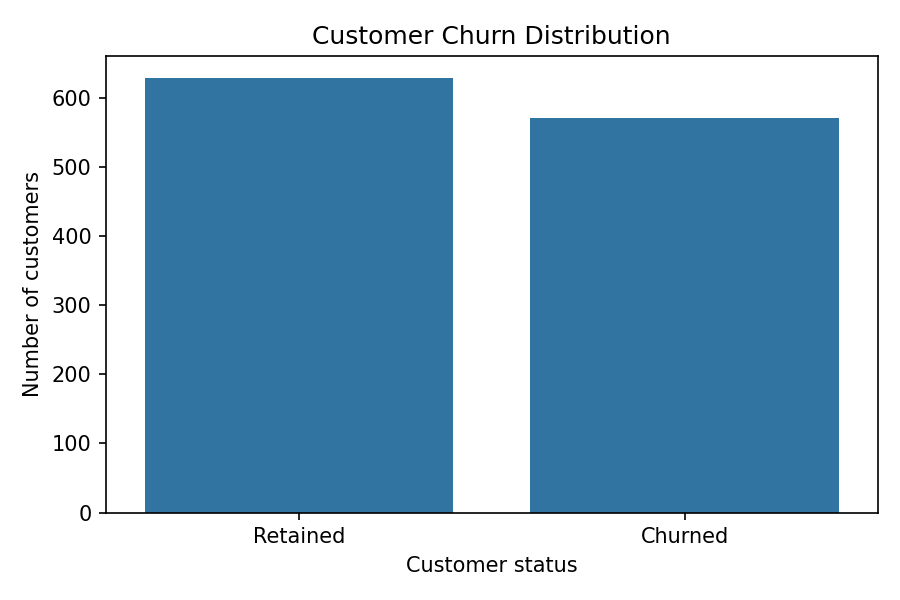
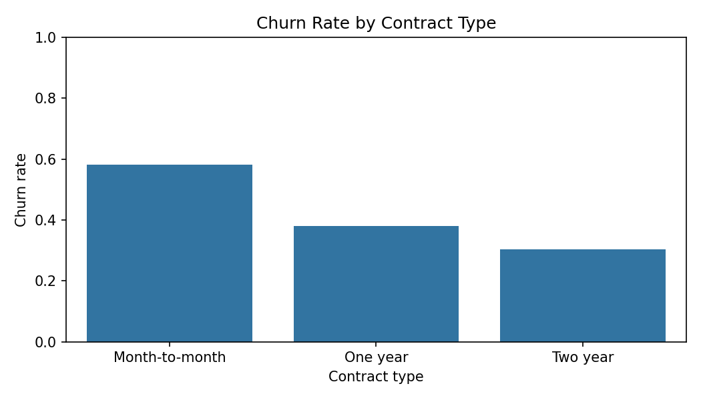
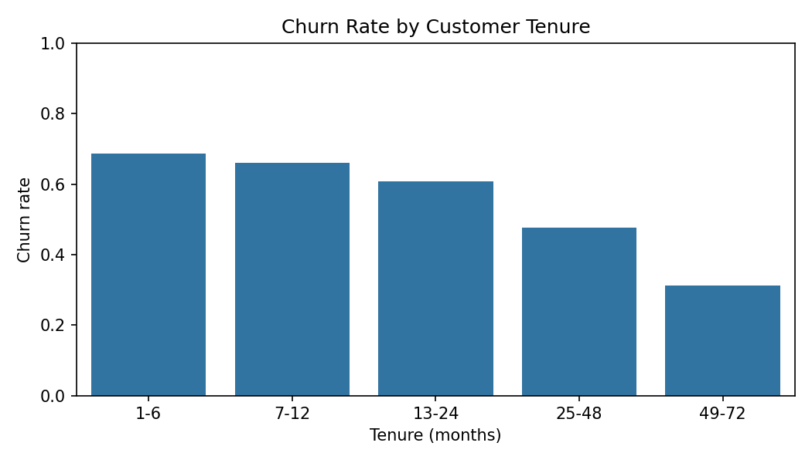

# Customer Churn Investigation

A beginner-friendly data science project that uses a **simulated subscription dataset** to investigate customer churn, identify patterns across customer segments, and recommend retention actions.

> **Data notice:** The dataset is synthetic. It does not represent a real company or real customers. Findings must be interpreted as results from simulated data, not evidence about an actual business.

## Business problem
A subscription business wants to understand which customer and account characteristics are associated with churn so its retention team can prioritize improvements.

## Stakeholder and decision
- **Primary stakeholder:** Customer Retention / Business Operations Manager.
- **Decision supported:** Which customer segments should be reviewed for retention interventions?
- **Success measures:** Reproducible data generation, documented data-quality checks, interpretable churn metrics, segment comparisons, and actionable recommendations supported by calculated results.

## Key results
- **Overall churn rate:** 47.58%
- **Month-to-month churn:** 58.18% (660 customers)
- **One-year contract churn:** 38.08% (302 customers)
- **Two-year contract churn:** 30.25% (238 customers)
- **Average tenure:** 30.57 months for churned customers vs. 42.50 months for retained customers
- **Average support tickets:** 1.51 for churned customers vs. 1.22 for retained customers

These are descriptive results from the simulated dataset. They do not establish causation.

## Visualizations







## Project files

| File | Description |
|---|---|
| [src/generate_data.py](src/generate_data.py) | Generates the reproducible synthetic dataset |
| [src/analyze_churn.py](src/analyze_churn.py) | Performs data checks, analysis and chart generation |
| [docs/data_dictionary.md](docs/data_dictionary.md) | Explains dataset columns |
| [subscription_customers.csv](subscription_customers.csv) | Generated customer dataset |
| [contract_churn_summary.csv](contract_churn_summary.csv) | Churn summary by contract type |
| [initial_findings.md](initial_findings.md) | Initial analysis findings |
| [validation_report.md](validation_report.md) | Data-quality validation results |
| [business_insights.md](business_insights.md) | Business interpretation and recommendations |
| [churn_distribution.png](churn_distribution.png) | Overall churn visualization |
| [churn_by_contract.png](churn_by_contract.png) | Contract-wise churn visualization |
| [churn_by_tenure.png](churn_by_tenure.png) | Tenure-related churn visualization |

## Setup and run
Python 3.10+ is recommended.

```bash
pip install -r requirements.txt
python src/generate_data.py
python src/analyze_churn.py
```

The scripts generate the working dataset and analysis outputs in the `data/` and `outputs/` folders when run locally. The selected result files are also included at the repository root for easy review.

## Analysis questions
1. What percentage of customers churned?
2. Does churn differ across contract types?
3. How does churn vary by customer tenure?
4. Are support-ticket counts associated with churn?
5. Which segments should the retention team investigate first?

## Limitations
- Data is simulated using predefined assumptions and is not evidence about a real business.
- Patterns are descriptive associations, not proof of causation.
- Results depend on the assumptions in the data generator.
- No predictive model or real-world retention impact is claimed.

## Next improvements
Use a properly licensed real-world dataset, add statistical uncertainty checks, compare retention cohorts over time, and evaluate retention interventions using an appropriate experiment.

## References
This project follows the scope and deliverables in the Arrowstack Data Science 1-Month Internship handbook, Project 1: Customer Churn Investigation.
